## Overview

### Big idea, small first step

> The MVP serves as a platform to engage users in rituals, provide guidance through life principles, spread the church’s philosophy, and track user progress.
>
> How we described it at the time

The first version grew into a full social app — news, channels, chats and profiles. Building it showed us it was far too much to start from, so we cut it back to a focused MVP: daily rituals, advice and recommendations, and a personal progress counter.

I designed my part, we were all happy with the result — and then life happened and we moved on to other projects. Maybe one day we’ll come back to it.

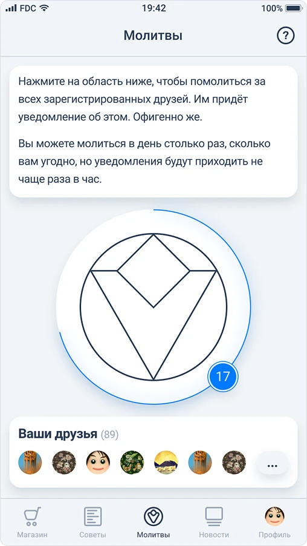

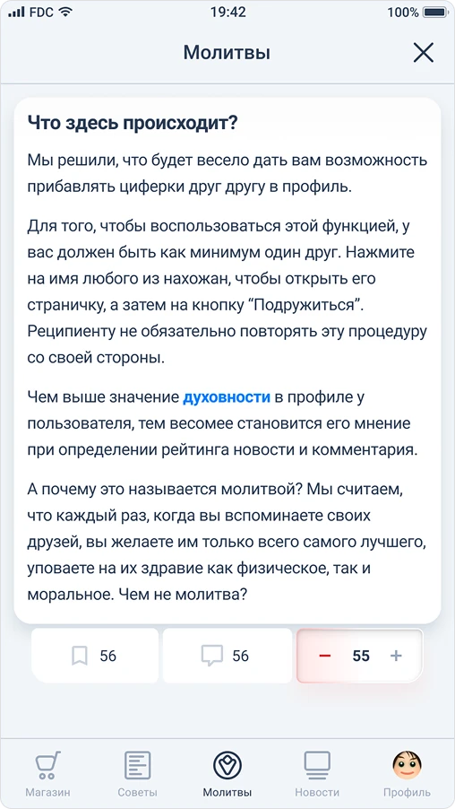

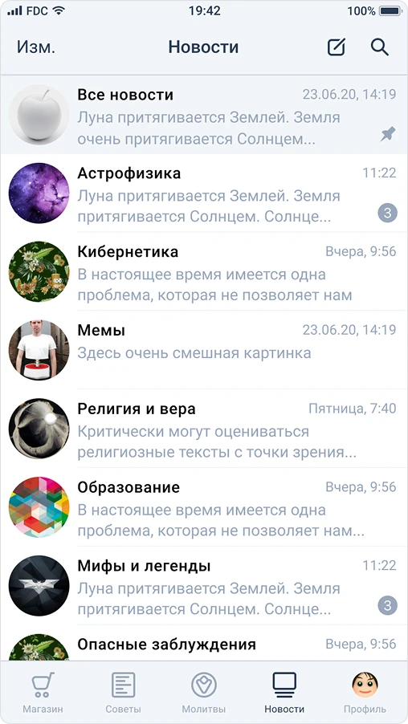

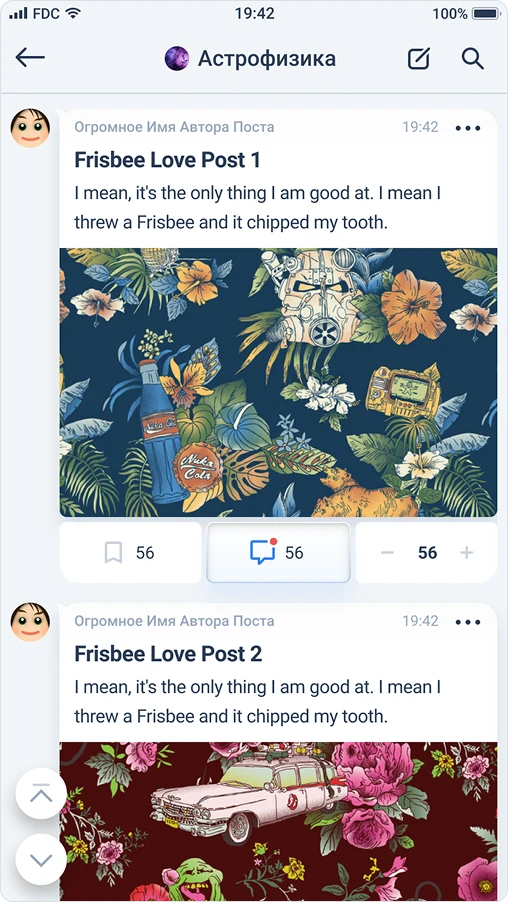

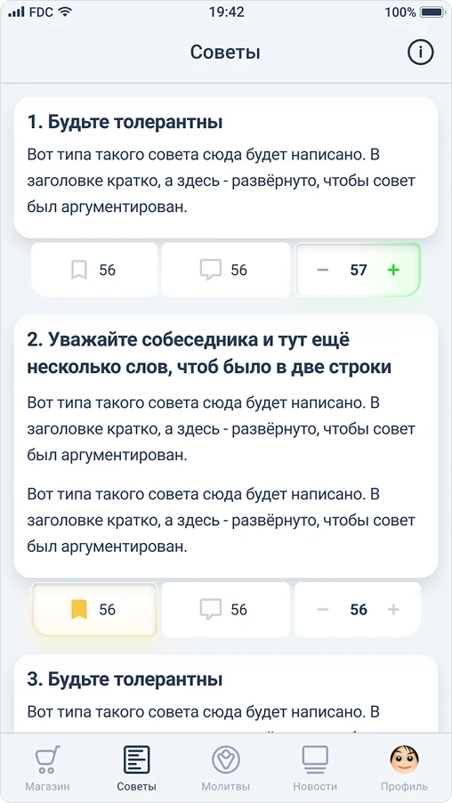

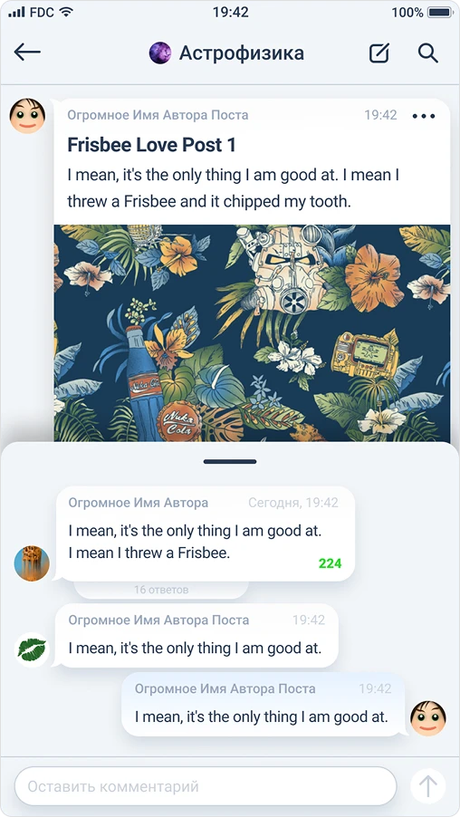

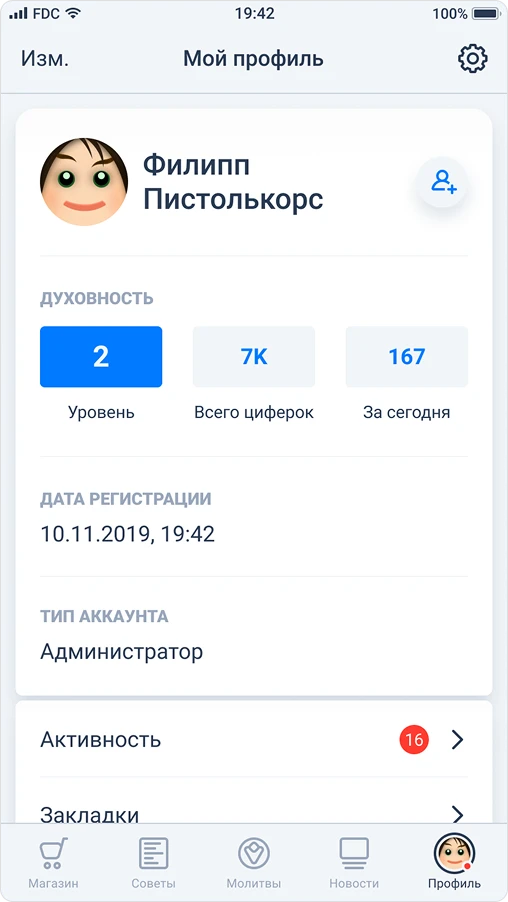

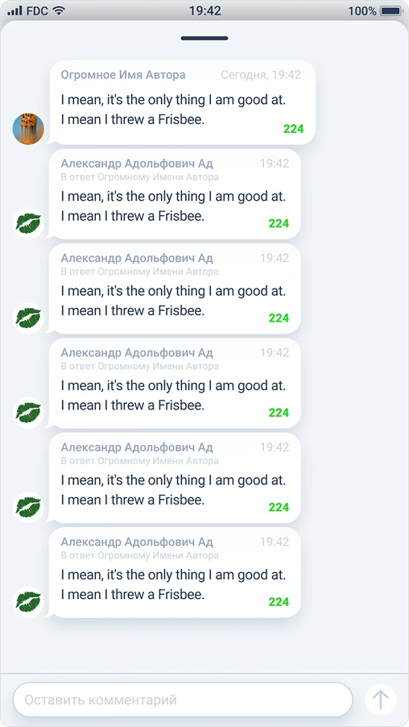

### Why we cut it down

The first version was built around messenger-like activity, with a strong focus on “channels” similar to Telegram. Each channel was a topic, users could create new ones freely, and every topic had its own comment section designed to feel like a lively chat.

At first the structure seemed ideal. But after some internal estimates — without any real user testing — we saw it was too complex for our stage. With no active users yet, it would feel empty and overwhelming rather than vibrant and welcoming. Channels and chats need constant activity, which we couldn’t guarantee, so instead of building momentum the app risked highlighting the lack of users.

So we pivoted to a lighter MVP: fewer features, a simpler structure, and a focus on a small but meaningful community first — letting growth happen naturally over time.

### The MVP concept

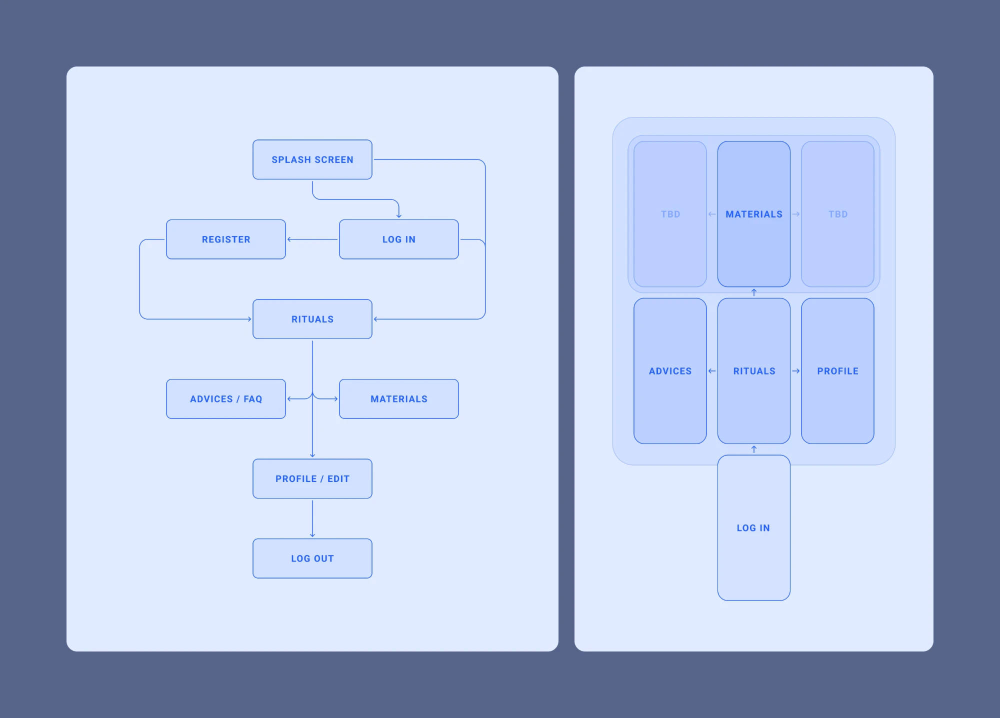

The MVP was based on the previous app’s idea but without most of the social activities. We wanted it to be not like a regular mobile application, but with some kind of twist.

So, as part of the experiment, I proposed that our team skip a menu with 3–4 sections and have one canvas instead, where you navigate seamlessly, mostly by swipes.

They liked the idea, so we settled on this concept.

### Wireframes

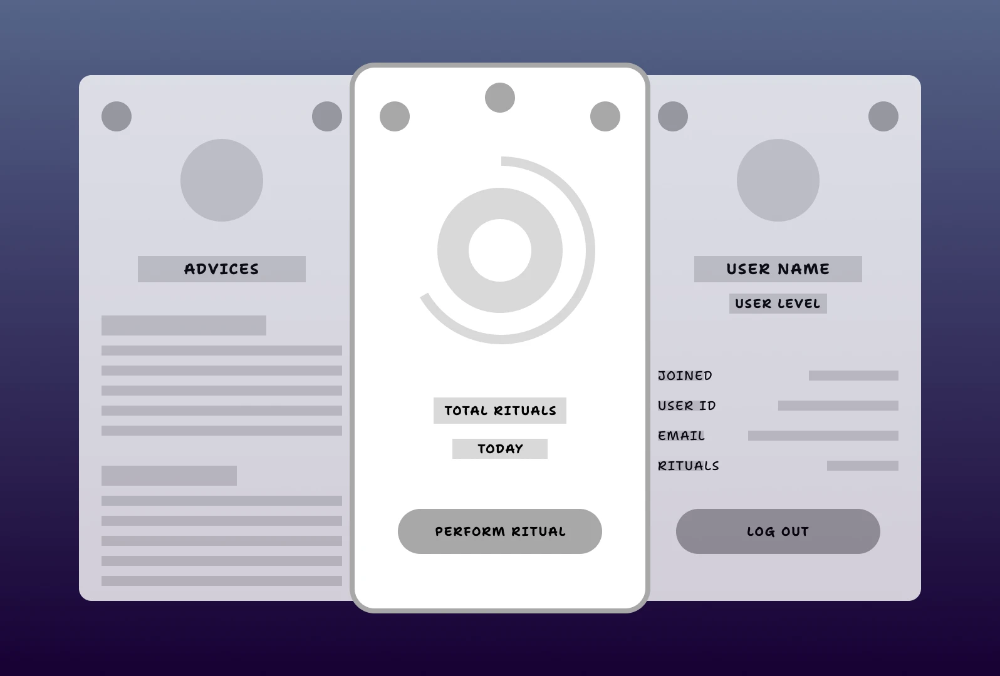

The whole app is three screens on one canvas: advices on the left, the ritual in the centre and the profile on the right, and you move between them by swiping. I tried to create something interesting and unusual, but not completely alien to the user.

### Final design

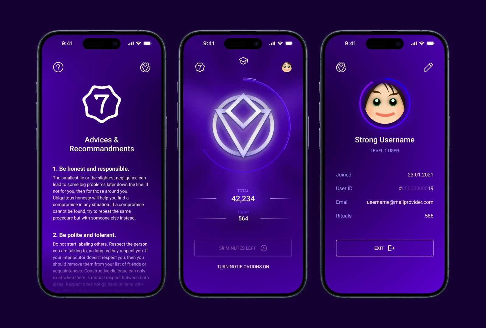

The final design keeps the same three screens. Pressing the ritual button is followed by a short shining animation of the church’s symbol, and every other interaction is slightly animated too.

### Back to it in 2026

For years the app stayed a design. In 2026 I finally came back to it, this time to build it myself. I’m vibe coding it with Cursor, Codex and Claude: I describe the screens, the swipe canvas and the ritual flow, and the tools write the code while I review it, steer it and fix whatever doesn’t feel right.

The user flow, the wireframes and the final design from back then now work as the brief. It’s a very different way of making a product than in 2020, when an MVP needed a team — and the idea that was shelved is moving again.
