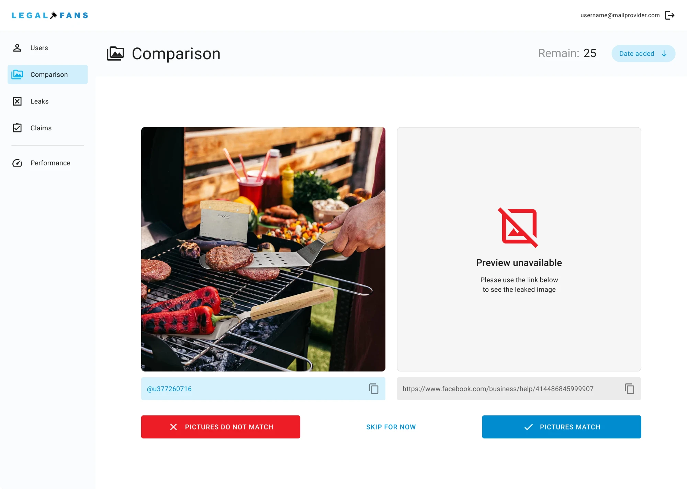
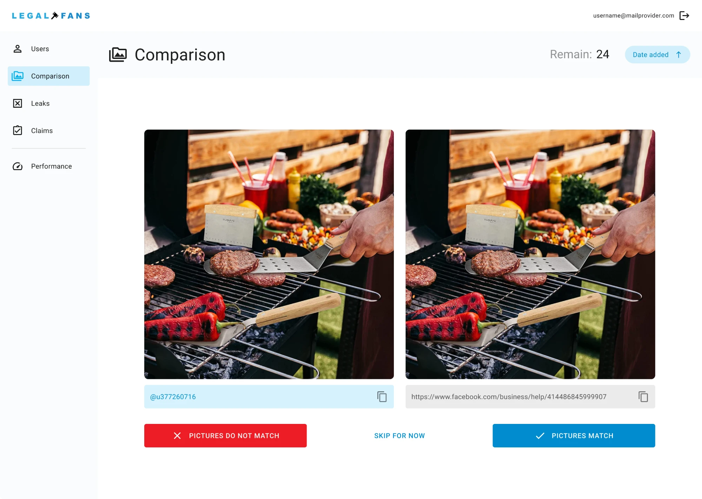
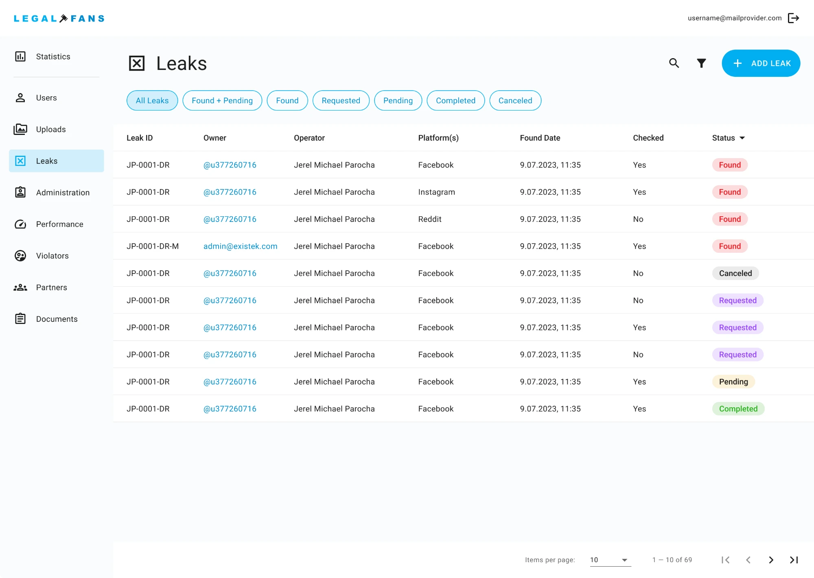
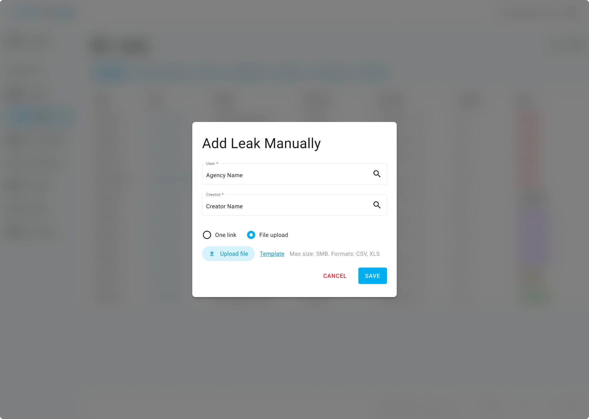
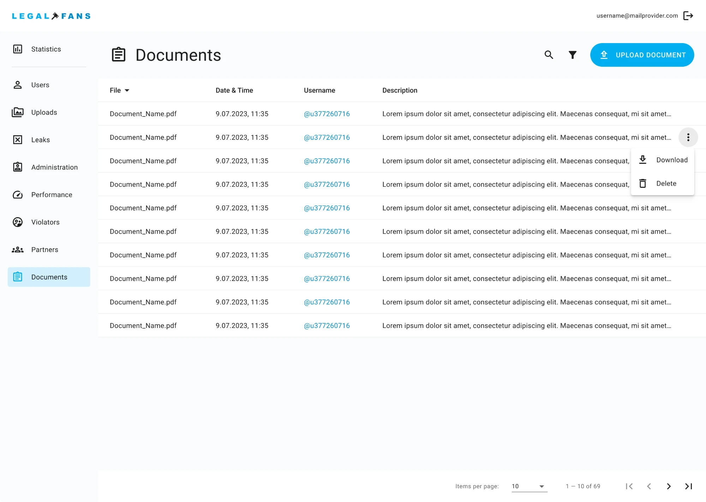
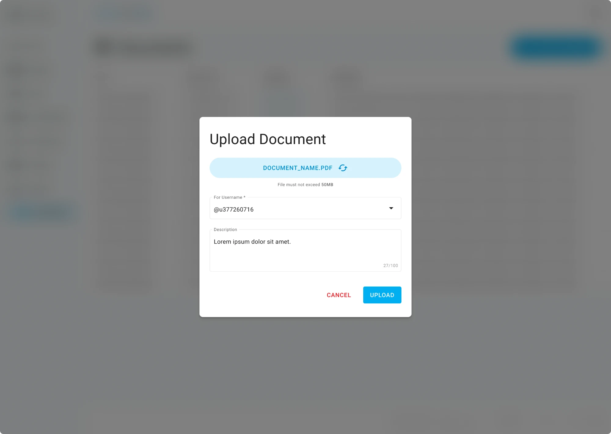

## Problem

### Creators were fighting leaks by hand — and losing

Leaked content means lost income, stress and damage to a creator’s reputation. Existing tools made creators find every copy and file every report themselves. Sites routinely ignored individual takedown requests, and few creators could afford lawyers.

> How might we detect, validate and remove leaked content automatically — with legal enforcement built in?

## Users and flow

### Three roles, one pipeline

<b>Creators and agencies</b>Protect content and revenue without technical skills or spare time.

<b>Operators</b>Review AI matches and remove false positives before anything goes legal.

<b>Lawyers</b>Receive validated cases and send takedowns at volume.

### Meet Emma, the primary user

<dl class="persona__id">

<dt>Name</dt><dd>Emma Carter, 28</dd>

<dt>Occupation</dt><dd>Full-time content creator</dd>

<dt>Location</dt><dd>Los Angeles, CA</dd>

</dl>

Emma has been a content creator for over three years, building a loyal fanbase and generating a stable income through subscriptions. Recently, she discovered her content was being leaked on various websites without her consent, impacting her revenue and personal well-being. She lacks the time and technical knowledge to manually track and report these violations.

Goals

<ul>
<li>Protect her content and revenue from unauthorized distribution.</li>
<li>Find an easy, automated way to detect and remove leaked content.</li>
<li>Maintain control over her brand and digital presence.</li>
</ul>

Frustrations

<ul>
<li>Manual takedown processes are slow and ineffective.</li>
<li>Many websites ignore her removal requests.</li>
<li>Emma feels vulnerable and lacks legal resources to fight back.</li>
</ul>

How LegalFans helps

<ul>
<li>Automatically scans and detects unauthorized use of her content.</li>
<li>Provides a seamless way to initiate legal takedown requests.</li>
<li>Gives her peace of mind by handling the enforcement process.</li>
</ul>

### Her path through the product

<ol class="flow">
<li>01 · CreatorSigns in securely</li>
<li>02 · CreatorLinks OnlyFans account</li>
<li>03 · CreatorInstalls the extension</li>
<li>04 · AIScans the web for copies</li>
<li class="is-accent">05 · OperatorValidates each match</li>
<li class="is-accent">06 · LawyerSends the takedown</li>
<li>07 · ResultLeak is removed</li>
</ol>

### From the first flow to the detailed one

<figure class="case-motion" data-lightbox-group>
<video src="../../motion/legalfans-flow.mp4" poster="../../motion/legalfans-flow.jpg" width="1440" height="1024" muted loop playsinline preload="metadata" aria-label="A first, high-level flow shows the creator, operator and admin lanes; Statistics opens into its low-fidelity wireframe, and the Statistics, My Account, Magic Vault and Leak wireframes are sketched in pencil and shaded in one after another; the Leak screen shrinks back into the flow, the four researched steps light up and move into a detailed flow that grows around them: sign-up, sources, the vault, leaks and search settings, the browser extension, the operator's match check and the admin sections" data-label="A first, high-level flow shows the creator, operator and admin lanes; Statistics opens into its low-fidelity wireframe, and the Statistics, My Account, Magic Vault and Leak wireframes are sketched in pencil and shaded in one after another; the Leak screen shrinks back into the flow, the four researched steps light up and move into a detailed flow that grows around them: sign-up, sources, the vault, leaks and search settings, the browser extension, the operator's match check and the admin sections"></video>
<figcaption class="eyebrow">From a first flow and its wireframes to the detailed flow</figcaption>
</figure>

## Key decisions

### Three calls that shaped the product

#### AI finds, a human confirms

Fully automatic matching produced false positives, and a wrong takedown damages trust and creates legal risk. We added operator validation between detection and legal action, so every case a lawyer receives has already been checked by a person.

*Comparison view — the operator checks the original against the suspected copy before a case goes to a lawyer.*

#### A dashboard that answers one question: am I protected?

Creators don’t want to manage cases; they want to know they’re covered. The statistics view leads with leaks detected and removed, and keeps the legal detail one level down. Even the empty state explains what will appear there.

<figure class="case-motion" data-lightbox-group>
<video src="../../motion/legalfans-stats.mp4" poster="../../motion/legalfans-stats.jpg" width="1440" height="1024" muted loop playsinline preload="metadata" aria-label="A creator with no data yet sees the empty statistics view, which suggests adding media to the Magic Vault or installing the extension; switching to all creators fills the dashboard: leaks detected and removed, removal percentage, top creator position, total media, the current leaks donut and upload dynamics, and the red slice shows 19 leaks found" data-label="A creator with no data yet sees the empty statistics view, which suggests adding media to the Magic Vault or installing the extension; switching to all creators fills the dashboard: leaks detected and removed, removal percentage, top creator position, total media, the current leaks donut and upload dynamics, and the red slice shows 19 leaks found"></video>
<figcaption class="eyebrow">From the empty state to the dashboard with data</figcaption>
</figure>

#### Guided setup for non-technical users

Connecting an account and installing an extension are where people give up. The extension walks creators through it step by step — connect, synchronise, done — and always shows how far along they are.

<figure class="case-motion" data-lightbox-group>
<video src="../../motion/legalfans-setup.mp4" poster="../../motion/legalfans-setup.jpg" width="1350" height="920" muted loop playsinline preload="metadata" aria-label="The extension welcomes the creator and offers to connect an OnlyFans account or sign up; after Connect it shows the last synchronisation, Monday 12 June, 2025, and Start Scan Now turns the button into a progress bar that runs to 100% while the circles above pulse and a note asks not to close OnlyFans; then a check draws itself, Synchronisation Successful, and Close Extension" data-label="The extension welcomes the creator and offers to connect an OnlyFans account or sign up; after Connect it shows the last synchronisation, Monday 12 June, 2025, and Start Scan Now turns the button into a progress bar that runs to 100% while the circles above pulse and a note asks not to close OnlyFans; then a check draws itself, Synchronisation Successful, and Close Extension"></video>
<figcaption class="eyebrow">Connect, synchronise, done</figcaption>
</figure>

## Final screens

### The creator view

<figure class="case-motion" data-lightbox-group>
<video src="../../motion/legalfans-vault.mp4" poster="../../motion/legalfans-vault.jpg" width="1440" height="1024" muted loop playsinline preload="metadata" aria-label="In the Magic Vault grid of thumbnails, filters and a media counter, the cursor rests on an item waiting for a scan, then opens a kitten photo: item ID-587945, manually uploaded and scanned, 16 leaks, with the platforms, claim IDs and statuses Resolved, Found and Cancelled; the dialog closes back to the grid" data-label="In the Magic Vault grid of thumbnails, filters and a media counter, the cursor rests on an item waiting for a scan, then opens a kitten photo: item ID-587945, manually uploaded and scanned, 16 leaks, with the platforms, claim IDs and statuses Resolved, Found and Cancelled; the dialog closes back to the grid"></video>
</figure>

*Magic Vault — where creators add and manage all their content.*

<figure class="case-motion" data-lightbox-group>
<video src="../../motion/legalfans-leaks.mp4" poster="../../motion/legalfans-leaks.jpg" width="1440" height="1024" muted loop playsinline preload="metadata" aria-label="On Keyword Search, the query Jessica Sparkle + Onlyfans + xxx photo leak is searched across Google, Yahoo and Bing; while the progress runs, the hint points to the Leaks Tab, which opens leak JP-0001-DR: the preview found on reddit.com, its link, and the other leaks of the same image with statuses from Requested to Completed; Keyword Search in the menu brings back the search" data-label="On Keyword Search, the query Jessica Sparkle + Onlyfans + xxx photo leak is searched across Google, Yahoo and Bing; while the progress runs, the hint points to the Leaks Tab, which opens leak JP-0001-DR: the preview found on reddit.com, its link, and the other leaks of the same image with statuses from Requested to Completed; Keyword Search in the menu brings back the search"></video>
</figure>

*Keyword search and leaks — search by keyword, then one leak in detail.*

<figure class="case-motion" data-lightbox-group>
<video src="../../motion/legalfans-platforms.mp4" poster="../../motion/legalfans-platforms.jpg" width="1440" height="1024" muted loop playsinline preload="metadata" aria-label="On My Platforms, a creator with no platforms yet has picked Fansly and a username; turning on log-in information opens email and password fields, and after Submit and validate the empty-state illustration gives way to the table: Fansly is added, then Onlyfans, LoyalFans and Friends2Follow join it one by one" data-label="On My Platforms, a creator with no platforms yet has picked Fansly and a username; turning on log-in information opens email and password fields, and after Submit and validate the empty-state illustration gives way to the table: Fansly is added, then Onlyfans, LoyalFans and Friends2Follow join it one by one"></video>
</figure>

*My Platforms — cam sites and socials the team monitors on the creator’s behalf.*

<figure class="case-motion" data-lightbox-group>
<video src="../../motion/legalfans-account.mp4" poster="../../motion/legalfans-account.jpg" width="1440" height="1024" muted loop playsinline preload="metadata" aria-label="On My Account, a creator on the Basic Plan with the next charge on 02.12.2025 clicks Upgrade; the subscription plans open, Basic, Advanced and Premium at $69, $129 and $149 a license, the cursor rests on Premium's Choose plan, and Cancel closes the plans back to the account" data-label="On My Account, a creator on the Basic Plan with the next charge on 02.12.2025 clicks Upgrade; the subscription plans open, Basic, Advanced and Premium at $69, $129 and $149 a license, the cursor rests on Premium's Choose plan, and Cancel closes the plans back to the account"></video>
</figure>

*My Account — profile and subscription upgrade.*

### The admin panel

*Leaks — every detected copy in one list, with manual entry for anything the AI missed.*

*Documents — the legal paperwork behind each takedown.*

## Lessons

### What I’d keep, and what I learned

<ol class="rows">
<li>Automation needs a human checkpoint. Speed means nothing if a wrong takedown costs trust.</li>
<li>Legal processes differ by jurisdiction, so the flow has to bend without breaking the creator’s view.</li>
<li>Showing progress openly — even “still in review” — builds more trust than silence.</li>
</ol>

Next on the roadmap: more accurate AI detection, more platforms and faster legal processing through further automation.
