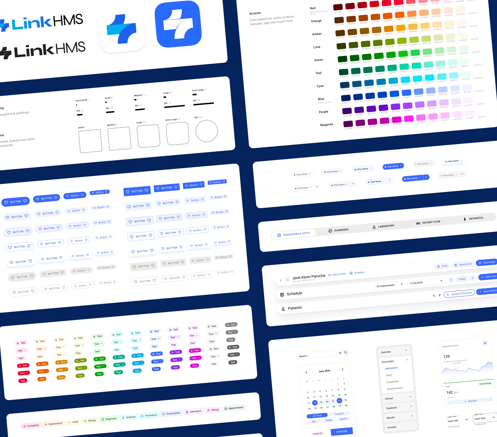
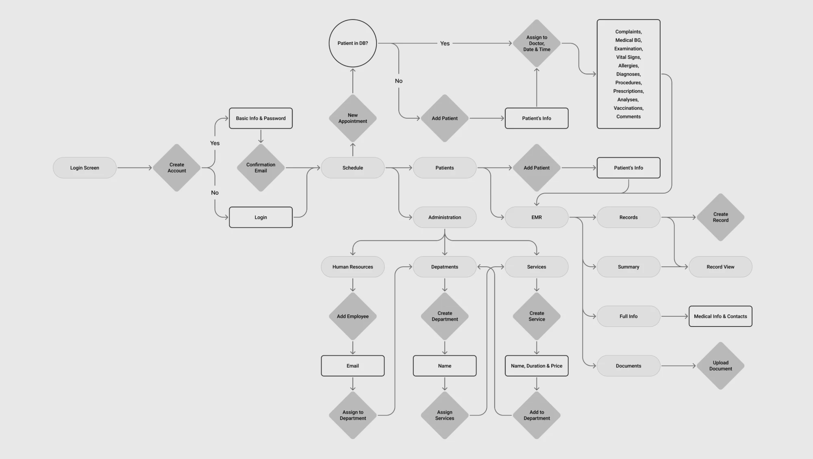
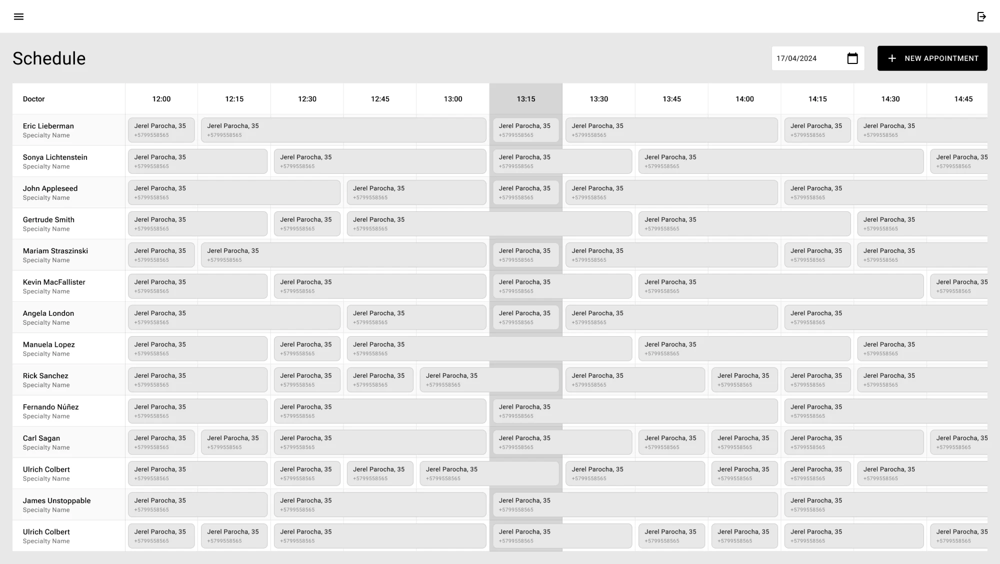
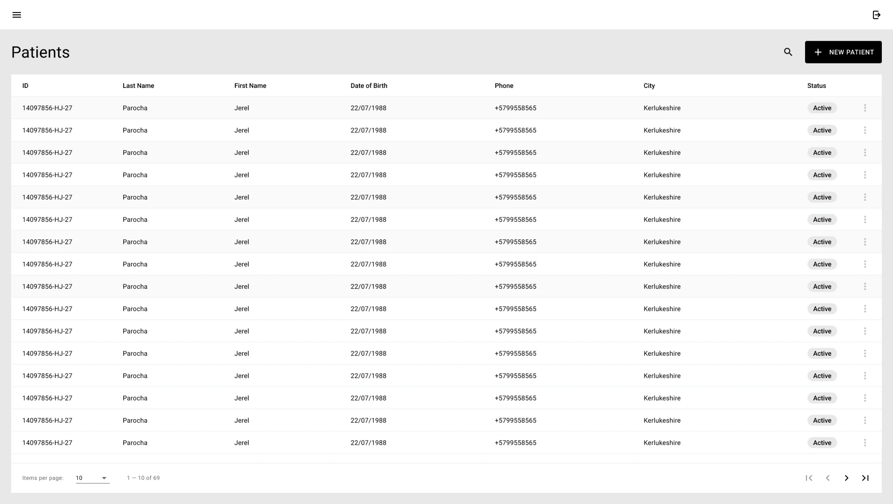
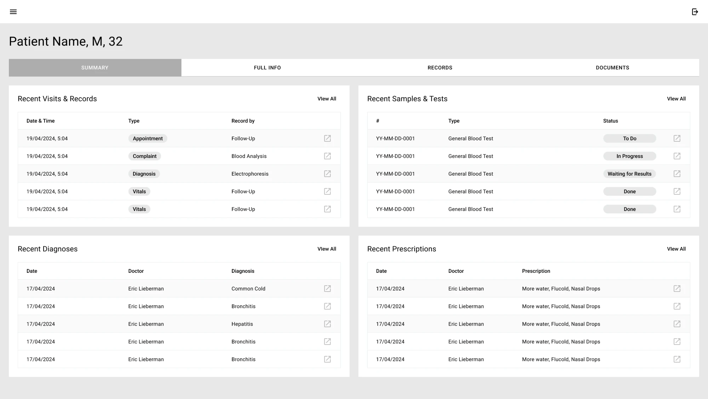
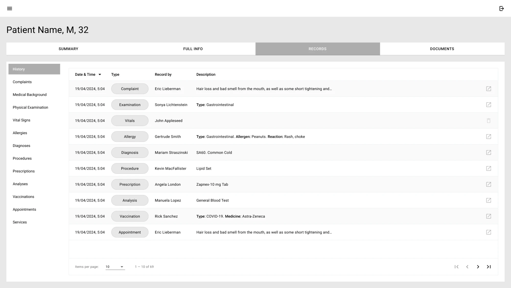
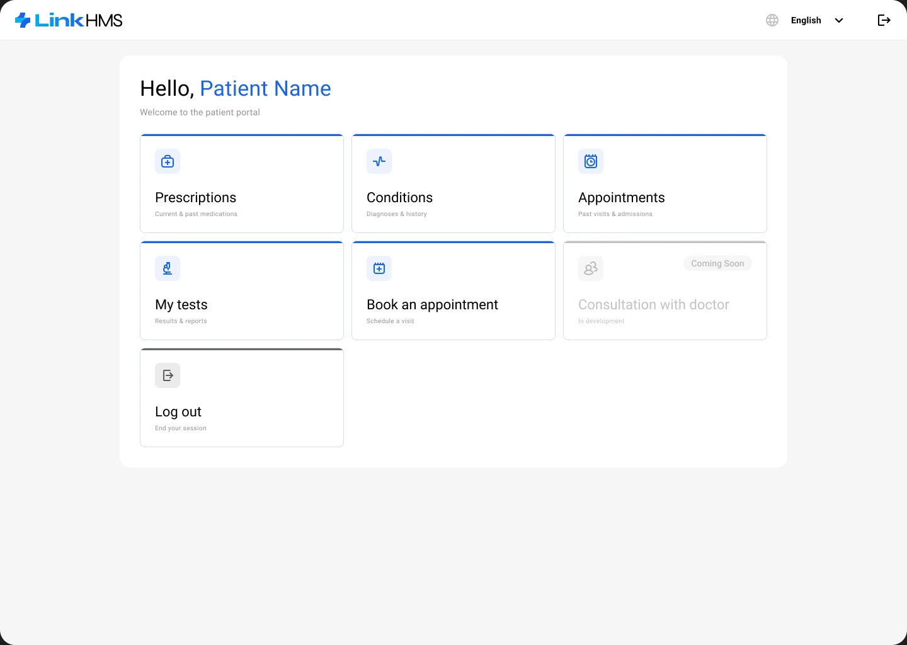
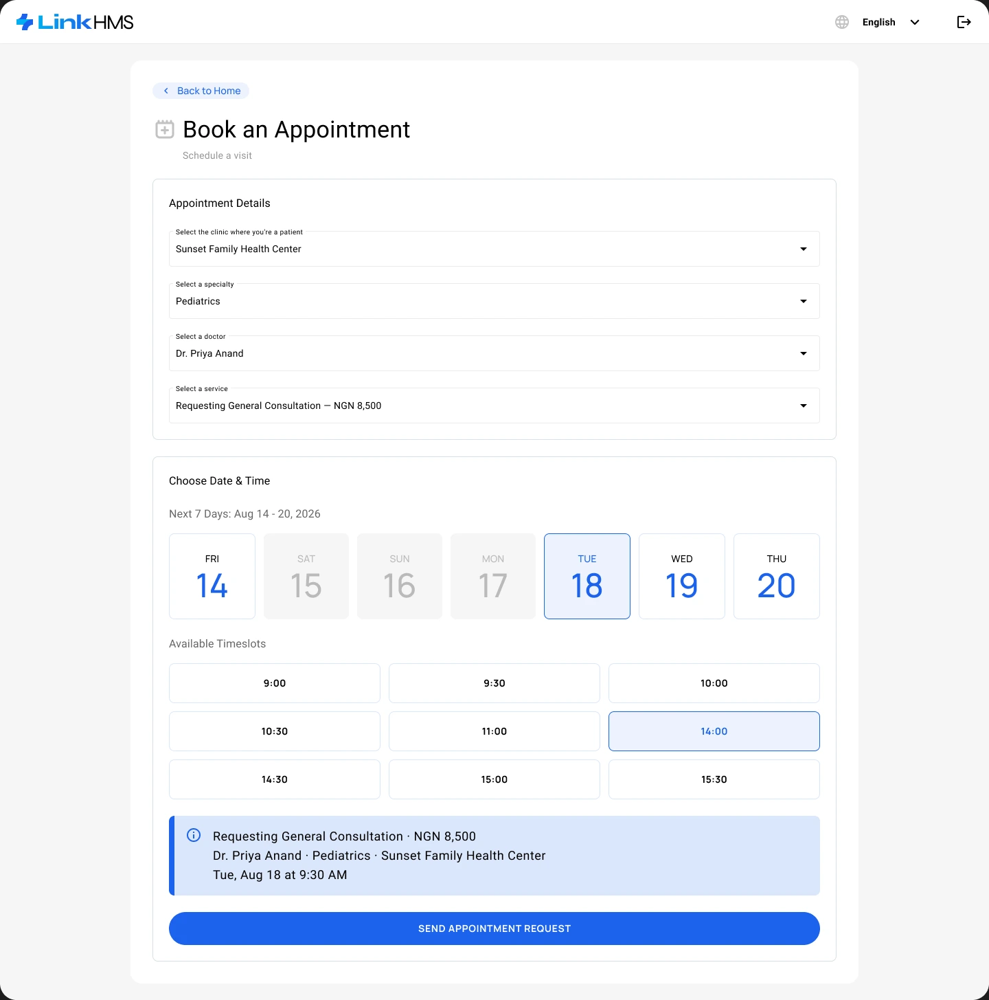
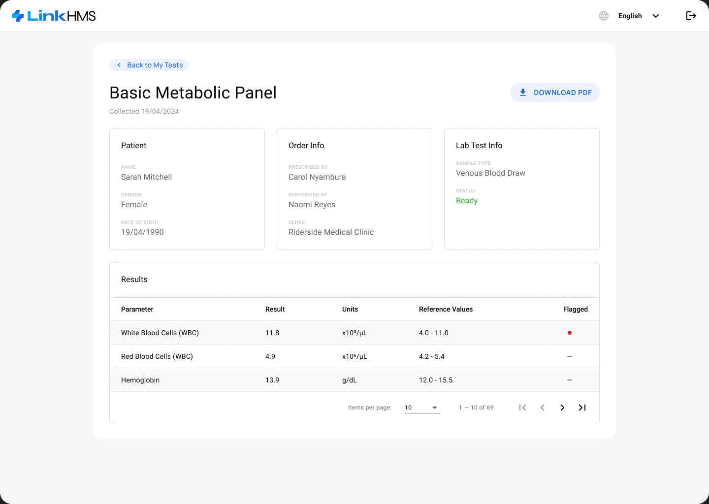

## Brand and design system

### Calm, clinical, recognisable

A distinct identity set LinkHMS apart from dated competitors. The UI takes its cue from modern healthcare facilities: clean, minimal and patient-centric. To keep it consistent as the product grows, I defined design tokens for numeric values, colour and type and built every component on top of them, from small elements to the blocks assembled from them.

## Problem and research

### Hospital software ignores the small clinic

Most HMS products are heavy, dated and aimed at large hospitals. Smaller clinics and solo practitioners are left juggling paper records and slow tools that were never meant for them.

I surveyed 12 healthcare professionals, interviewed 5 of them and analysed 4 competing products to understand how they manage patients, scheduling and communication.

- Clinicians juggle several systems for records, appointments and communication.
- Staff value being able to tailor patient records and scheduling to their own workflow.
- Existing tools feel outdated, hard to use and unreliable.
- A clear dashboard for scheduling and patients is essential for quick decisions.

<b>Challenge</b>Design a streamlined system that covers the core needs of most clinics and individual practitioners.

<b>Solution</b>Combine and improve on the strongest features of competitors to simplify internal cooperation and patient–clinic interaction.

I grouped the findings in an affinity diagram, graded features by importance and built a persona — Kwame, a physical therapist working across several public and private clinics — to test every decision against.

### Meet Kwame, the primary user

<dl class="persona__id">

<dt>Name</dt><dd>Kwame, 36</dd>

<dt>Occupation</dt><dd>Physical therapist</dd>

<dt>Location</dt><dd>West Africa</dd>

<dt>Environment</dt><dd>Multiple public and private clinics</dd>

<dt>Tech</dt><dd>100% desktop</dd>

</dl>

“Managing patient records and appointments was a constant struggle with slow software and endless paperwork. It took time away from patient care.”

Goals

<ul>
<li>Faster access to medical records.</li>
<li>Streamlined appointment scheduling.</li>
<li>Less administrative workload.</li>
<li>Better communication with other staff.</li>
</ul>

Frustrations

<ul>
<li>Outdated systems that delay access to patient data.</li>
<li>Difficulty managing large volumes of paperwork.</li>
<li>Lack of integration between different departments.</li>
</ul>

## Process

### From sketches to a tested flow

I started with hand-drawn sketches to decide what each screen needed, then mapped the user flow and built a low-fidelity prototype in Figma. A usability study showed where the task flow broke down; a second round confirmed the fixes before any high-fidelity work.

### Mentoring on the project

A mid-level designer worked on LinkHMS with me, and I trained them on the project itself: the clinic domain, the design system and how a flow goes from sketch to developer hand-off. I reviewed their screens before they went to the developers, so the product kept one design language while two people worked on it.

## Scope

### From the front desk to the finance office

LinkHMS covers a clinic’s whole day in nine areas, from the first booking at the front desk to the month’s numbers in the finance office.

<b>Schedule and queue</b>Doctors’ appointments on a timeslot grid and a daily live queue by status: book, edit, cancel, start and complete visits.

<b>Patients and records</b>A searchable patient registry and an electronic record for every patient to view and add clinical entries, with photo upload.

<b>Visits and admissions</b>Document a visit — vitals, diagnoses, prescriptions, analyses, services — convert it to an admission and follow it through discharge.

<b>Billing and claims</b>Itemised invoices, payments, printing and sending, and insurance claims tracked from draft through submission to the insurer’s decision.

<b>Pharmacy</b>Prescription orders dispensed from stock and billed to the patient or the insurer, and a medicine inventory with CSV or Excel upload.

<b>Laboratory</b>Lab orders tracked by status, results entered with attachments and sent to the patient, and custom test templates next to the built-in ones.

<b>Reports</b>Operational reports on admissions, diagnoses, lab tests, patient flow and antenatal care, and finance reports on what was billed, collected and is outstanding.

<b>Administration and HR</b>Departments, services, insurance providers with plan-based pricing, API keys, and staff accounts with roles and weekly schedules.

<b>Settings and permissions</b>Account and clinic details, invoice text, working hours, subscription billing and view and edit permissions for every role.

## Key decisions

### Flows that run a clinic

With the identity and the components in place, here are the flows where speed mattered most.

#### One account type, set up with a guided tour

LinkHMS launched with two account types: an individual practice for a doctor working alone, and a clinic for a team.

<b>What we found</b>In several small clinics, a few people were working in one individual account from a shared computer. No restriction we added stopped it, and keeping two account types meant maintaining two versions of the same flows for a line users did not respect.

<b>What we chose</b>We dropped the individual practice. A doctor working alone is now a clinic with one seat and keeps every feature, and a team shares the same system with roles — one product to maintain instead of two.

After sign-up, a short guided tour sets up the first department, service and user, and can be skipped.

<figure class="case-motion" data-lightbox-group>
<video src="../../motion/linkhms-clinic-signup.mp4" poster="../../motion/linkhms-clinic-signup.jpg" width="1920" height="1080" muted loop playsinline preload="metadata" aria-label="A clinic signs up for LinkHMS: the email and clinic name are typed, the rest of the form fills in, the terms are accepted, then each of the four set-up steps is started and the progress bar runs from 20% to 100%" data-label="A clinic signs up for LinkHMS: the email and clinic name are typed, the rest of the form fills in, the terms are accepted, then each of the four set-up steps is started and the progress bar runs from 20% to 100%"></video>
<figcaption class="eyebrow">From sign-up to a clinic all set up</figcaption>
</figure>

#### Booking ahead and walk-ins

Receptionists create an appointment for a specific doctor in just a few clicks, straight from the schedule. Not every patient books ahead, though: the Live Queue shows the day’s visits by status — waiting, ongoing, completed or cancelled — with urgent cases marked in red, and every row can start or complete a visit, convert it to an admission or open the patient’s profile. A walk-in is added in the same New Visit dialog, which finds the patient by name or phone number.

<figure class="case-motion" data-lightbox-group>
<video src="../../motion/linkhms-live-queue.mp4" poster="../../motion/linkhms-live-queue.jpg" width="1920" height="1080" muted loop playsinline preload="metadata" aria-label="From the schedule to the Live Queue of walk-ins: a doctor’s ongoing visit is completed from its row menu, her next waiting patient’s visit is started, and the schedule stays as it was" data-label="From the schedule to the Live Queue of walk-ins: a doctor’s ongoing visit is completed from its row menu, her next waiting patient’s visit is started, and the schedule stays as it was"></video>
<figcaption class="eyebrow">Walk-ins in their own queue, next to the schedule</figcaption>
</figure>

Show the other 3 flowsHide the other 3 flows

#### A medical record you can scan in seconds

The electronic medical record is split into sections and subsections, so a doctor jumps straight to what matters in an emergency.

<figure class="case-motion" data-lightbox-group>
<video src="../../motion/linkhms-medical-record.mp4" poster="../../motion/linkhms-medical-record.jpg" width="1920" height="1080" muted loop playsinline preload="metadata" aria-label="A patient’s record: from the summary to the full history, then through the section menu to the drug administration chart and the vaccination grid, where an overdue dose is given, and back to the summary" data-label="A patient’s record: from the summary to the full history, then through the section menu to the drug administration chart and the vaccination grid, where an overdue dose is given, and back to the summary"></video>
<figcaption class="eyebrow">Summary, history, drug chart and vaccinations in one record</figcaption>
</figure>

#### A patient photo without leaving the record

A photo is added right from the patient’s record: upload a file or take one with the device camera, check it, then save. If the file has the wrong format, the dialog says which formats work, and it warns before unsaved changes are lost.

<figure class="case-motion" data-lightbox-group>
<video src="../../motion/linkhms-patient-photo.mp4" poster="../../motion/linkhms-patient-photo.jpg" width="1920" height="1080" muted loop playsinline preload="metadata" aria-label="The patient’s photo added from the record: a file in the wrong format shows which formats work, the next upload shows the photo, Save confirms it, and the photo appears next to the patient’s name" data-label="The patient’s photo added from the record: a file in the wrong format shows which formats work, the next upload shows the photo, Save confirms it, and the photo appears next to the patient’s name"></video>
<figcaption class="eyebrow">Wrong format, upload, save, without leaving the record</figcaption>
</figure>

#### Reports that point to the problem

Finance reports open on six numbers — billed, collected, outstanding, collection rate, average invoice and denied claims — followed by the trend, revenue by department, the payment mix and the claim pipeline. Clicking a tile or a chart segment filters the “Attention needed” table of flagged invoices below, and each invoice opens in one click.

<figure class="case-motion" data-lightbox-group>
<video src="../../motion/linkhms-reports.mp4" poster="../../motion/linkhms-reports.jpg" width="1920" height="1080" muted loop playsinline preload="metadata" aria-label="The finance overview report: the pointer runs along the billed versus collected trend and over revenue by department, the payment mix and the claim pipeline, scrolls to the invoices that need attention, opens one invoice, then returns to the report from the main menu" data-label="The finance overview report: the pointer runs along the billed versus collected trend and over revenue by department, the payment mix and the claim pipeline, scrolls to the invoices that need attention, opens one invoice, then returns to the report from the main menu"></video>
<figcaption class="eyebrow">From a chart to the invoice behind it</figcaption>
</figure>

## Patient portal

### The same record, from the patient’s side

Patients sign in with their email and a six-digit one-time code. The home screen gathers their prescriptions, conditions, appointments and test results, and booking takes a single page: clinic, specialty, doctor and service with its price, then a day in the coming week and a free timeslot. A test result lists every parameter against its reference range, flags what is out of range and downloads as a PDF. The portal works on phones too.

## AI in the process

### Agents took on the slow parts, about half of the hands-on work

AI tools became part of the process as the project went on. Agents did not replace the design work: I made the decisions, they took on the slow parts between a design and working code.

#### The densest sections, prototyped in code

The heaviest sections were prototyped in code with AI agents (Cursor, Claude Code and Codex) instead of linked Figma frames, so the team could try them as working interfaces before development started.

<b>Reports</b>Operational reports on admissions, diagnoses, lab tests, patient flow and antenatal care.

<b>Finance reports</b>Billed, collected and outstanding, with charts that filter the invoices that need attention.

<b>Vaccinations</b>A schedule grid by age with a status for every vaccine.

<b>Partograph</b>The labour progress chart in the Pregnancies section.

<b>Prescriptions and drug administration</b>Medicines with route, dosage and status, and a log of every dose given.

#### A design system reworked in Figma, implemented by AI

I first built the design system by hand in Figma, and later reworked it there too. This time the changes went into the code base through AI agents rather than front-end developers: no one was taken off the roadmap, and the rework saved tens of hours of development.

## Lessons

### What I’d do differently

<ol class="rows">
<li>Watch clinics at work, not only ask them. Surveys and interviews never showed that in a small clinic two or three people share one computer — production did, and it cost a whole account type. A few days on site would have got the account model right the first time.</li>
<li>Measure the key flows from day one. Clarity was in place, but no funnels: there is still no number for how many clinics finish the onboarding tour, or where booking is dropped.</li>
<li>Build the design system in step with the code from the start. It lived in Figma first and later had to be reworked and carried into the code base by AI agents — a second pass that shared tokens and components would have saved.</li>
</ol>

## Next steps

### There is no limit to perfection

What started with registration, scheduling, patients and the medical record grew over two and a half years into a full clinic system, in production since 2025 and used by more than 30 clinics. Clinic staff keep coming back to it — 95% of sessions are from returning users — and 86% of sessions are on desktop, as the research predicted. It now covers a live queue, admissions with beds and discharge, billing and insurance claims, a pharmacy, a laboratory, reports and a patient portal. The product can grow in several directions:

- **Reminders and online payments** — appointment reminders for patients, and invoices paid from the portal instead of at the front desk.
- **Insurers connected directly** — claims sent to the insurer and decisions received inside LinkHMS, without retyping them by hand.
- **Stock that watches itself** — low-stock alerts and reorder suggestions based on what the pharmacy actually dispenses.
- **Insight beyond reports** — trends in patient flow, revenue and diagnoses, with an early warning when something drifts.
- **Chains of clinics** — one account for several branches, with shared patients, per-branch schedules and consolidated reports.
